# BROKEN FRONT

A realistic first-person military survival game for the browser.

Satgas Elang-7, an Indonesian security detachment, arrives in the German city of
Kreuzhafen for the Federal President's visit. On the way to the bus the squad stops
and looks up. *"KABUR! SEMUA, LARI!"* — aircraft fill the sky, the attackers pull out,
and a pre-planned strike levels the district around you. You wake up in the ruins
with a concussion, a broken phone and a scattered squad. Find them, keep them alive,
get a message home and survive **twelve days** until the rescue helicopter lands.

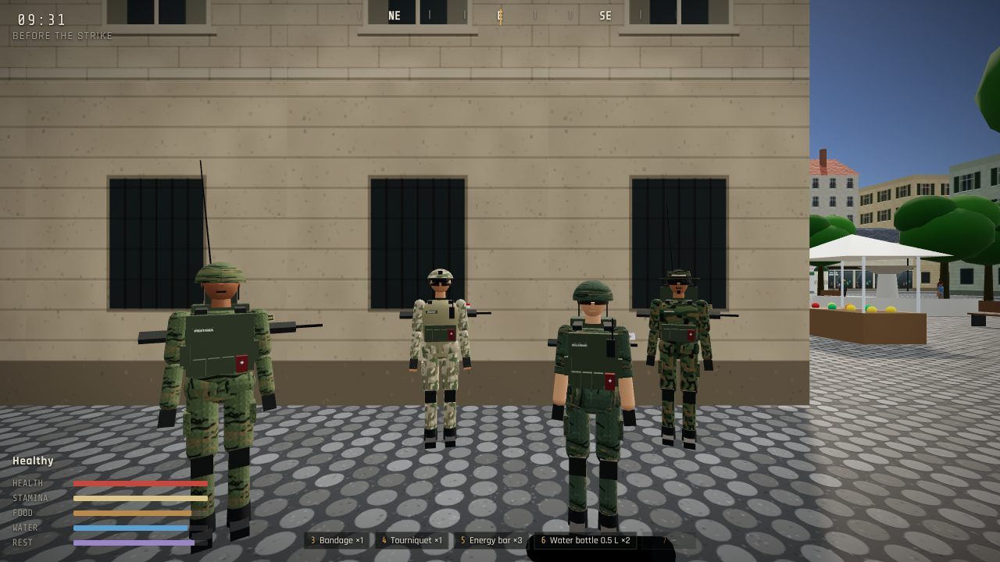

| | |
|---|---|
| 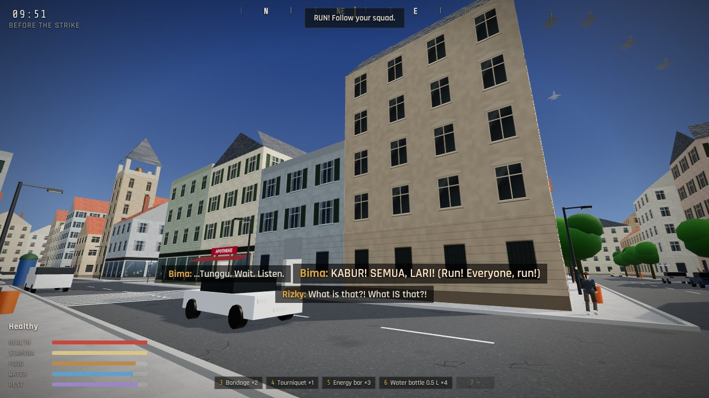 | 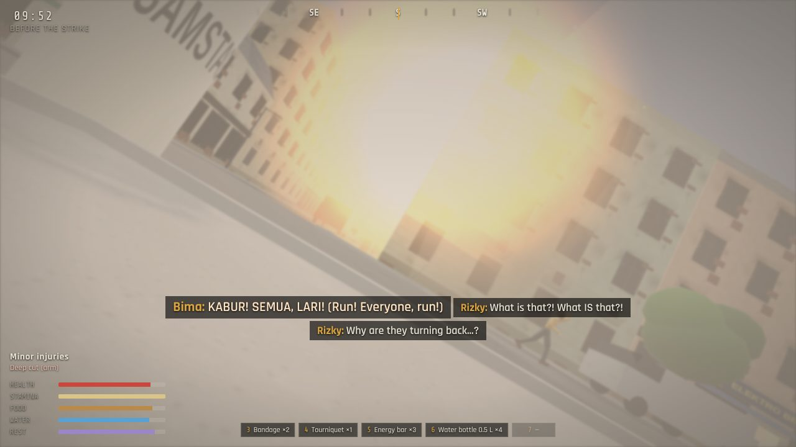 |
| 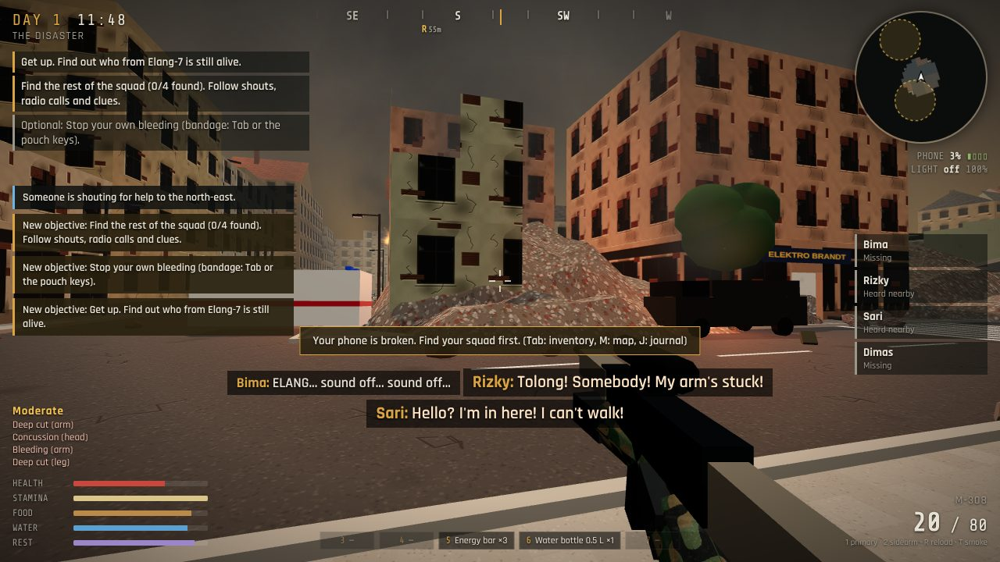 | 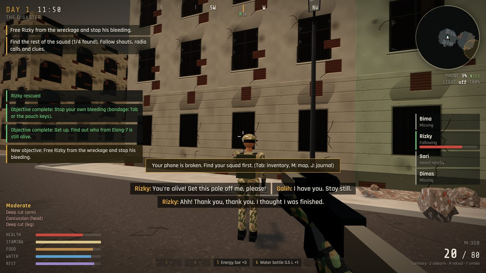 |
| 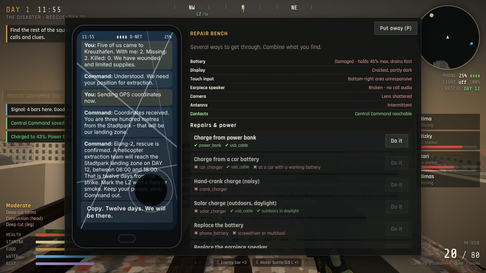 | 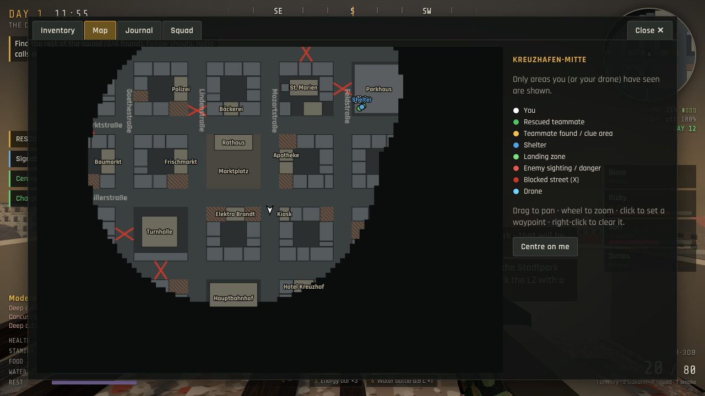 |
| 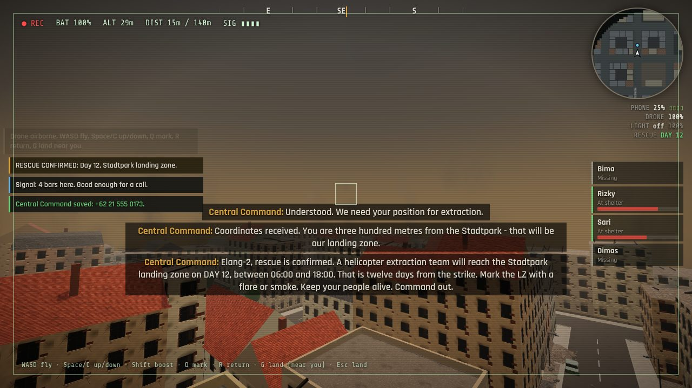 | 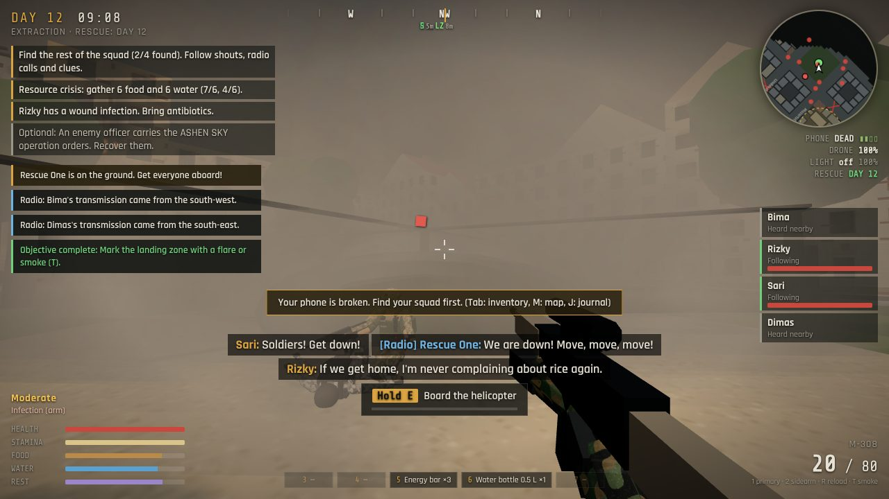 |
| 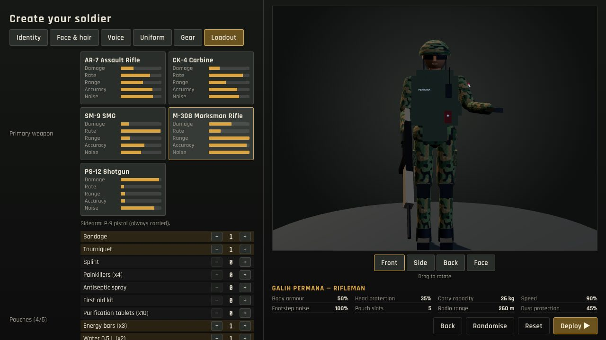 | 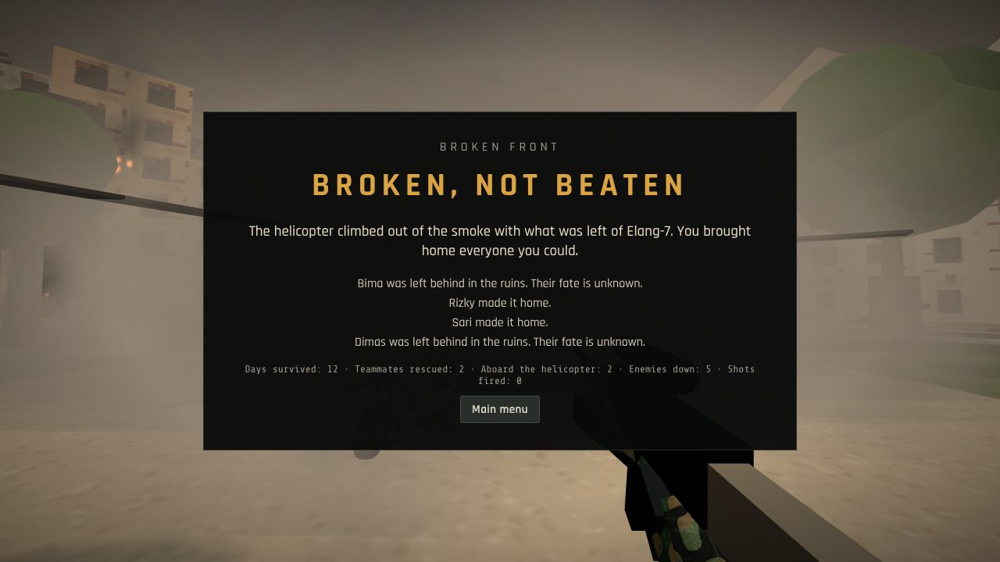 |

## Run it

1. Install [Node.js](https://nodejs.org) 18 or newer.
2. In this folder:

   ```bash
   npm install
   npm start
   ```

3. Open **http://localhost:3000** in a current Chrome, Edge or Firefox (WebGL 2 and a
   GPU are needed; headphones recommended).

`npm run build:static` writes a self-contained copy to `dist/` that any static web host
(e.g. GitHub Pages — see `.github/workflows/pages.yml`) can serve.

## Controls

| Key | Action |
|---|---|
| **W A S D** / mouse | Move / look (click the game to capture the mouse; if your browser refuses, drag to look) |
| **Shift** | Sprint (uses stamina) |
| **C** or **Ctrl** | Crouch — quieter and much harder to spot |
| **Space** | Jump |
| **E** (hold) | Interact: search, free, treat, talk, climb, clear debris, take down an unaware enemy from behind |
| **Left / right mouse** | Fire / aim down sights |
| **R** | Reload |
| **1 / 2** | Primary weapon / sidearm |
| **3 – 8** | Use the item in that vest pouch (pouches = your vest's slots) |
| **T** | Throw a smoke grenade (blocks enemy vision, marks the landing zone) |
| **F** | Flashlight |
| **G** | Deploy the drone (outdoors) / land it next to you |
| **P** | Phone |
| **Tab** or **I** · **M** · **J** · **K** | Inventory & equipment · Map · Journal · Squad |
| **Esc** | Close a window / pause (save, load, settings) |

In the drone: **WASD** fly, **Space / C** up/down, **Shift** boost, **Q** mark a point on
the map, **R** return home, **G** land, **Esc** land immediately.

## How the game plays

**Create your soldier.** Name, gender, face shape and features, skin, hair, eyes,
facial hair, voice (preset, pitch, speaking style, system voice — test it), military
role, uniform cut, colour and camouflage, helmet, vest, gloves, boots, backpack, knee
pads, eyewear, radio, name patch and insignia, primary weapon and the medical/survival
kit in your pouches. The preview shows front, side, back and face views. Every choice
changes the game: the vest sets armour and the number of pouch slots, the backpack
your carrying capacity, the helmet your head protection, goggles how much the dust
blinds you, boots and knee pads your noise, the radio whether you hear your squad's
transmissions, and the role gives a passive (medic heals faster, engineer clears
debris and repairs faster, marksman is quieter with more drone range, signaller gets
an extra signal bar, rifleman aims steadier and carries more ammunition).

**The opening.** Arrive on the Marktplatz, check your gear, shop for food, water,
medicine and a drone with a €320 budget, then walk to the bus with your squad. When
the squad stops and looks up — look up too. Run. The strike hits left, right, ahead and
behind you at the same moment. (You can skip the opening from the Deploy menu.)

**After the strike** the city is a different place: collapsed buildings, rubble-blocked
streets, fires, smoke, wrecked cars, broken windows, flashing emergency vehicles.
Courtyard archways and side streets are your detours.

**Find the squad.** Nobody's position is revealed. You learn where people are from
shouts you can hear (with direction), radio calls if you carry a radio, notes you pick
up, a flare on the second night, and your drone's camera. Each teammate needs
something different:

| Teammate | Situation | What you need |
|---|---|---|
| Kopda **Rizky** (rifleman) | Pinned under a fallen lamp post nearby, bleeding | Your hands, then a bandage |
| Pratu **Sari** (medic) | Leg broken, hiding somewhere with a red "A" sign | A splint, or a plank with tape or a bandage |
| Praka **Dimas** (signaller) | Unconscious in a damaged building near a church | A first aid kit to revive him |
| Serka **Bima** (leader) | Pinned under a concrete slab far away, bleeding badly, getting worse every hour | A hydraulic jack or crowbar (behind debris in the fire station, or at the Baumarkt), a tourniquet |

Untreated teammates deteriorate — some faster than others, so choose who to reach first.
Rescued teammates follow you (limping if hurt), take cover and return fire when enemies
attack, ask for food, water and medicine, and can be ordered to wait or go to the shelter
(by radio if you carry one). At the shelter they eat from the stash, the medic treats
the others, and the squad talks among itself.

**Survive.** Hunger, thirst, stamina and fatigue; bleeding, deep cuts that can get
infected, broken bones, concussion, burns, water sickness and unconsciousness — each
treated by specific supplies. Carrying too much slows you down. Every shelf, cabinet,
locker, car boot, suitcase and body is searched once; what you leave stays there, and
from Day 6 most places have already been picked over. Choose a shelter (the school gym
or the car park office), stock its stash and sleep there.

**Get a message home.** Your phone has a cracked display with a dead corner, a damaged
battery, a broken earpiece, an intermittent antenna and corrupted contacts. There is no
single fix — combine what you find:

- **Power:** power bank + cable, a car charger at a car with a working battery, a
  hand-crank charger (noisy), a solar charger in daylight, a replacement battery.
- **Audio:** earphones, or a replacement speaker and a screwdriver/multitool.
- **The number:** the unit's emergency card (in the squad vehicle wreck — or Bima has
  one), Dimas knows it by heart, or move your SIM into an abandoned phone.
- **Signal:** the streets have none; climb the St. Marien bell tower or walk up the
  Parkhaus ramps to the roof; copper wire boosts the antenna.
- **Or skip the phone:** a satellite phone (the President's security detail left one in
  the Rathaus), the police station's field radio with batteries and a frequency card,
  or your own manpack radio with a repaired antenna.

The call can fail — a weak signal drops it, a weak battery dies mid-call — and then you
find another way. Report your squad, send GPS or describe a landmark you have seen, and
Central Command confirms: **extraction on Day 12, 06:00–18:00, at the Stadtpark**. (Call
too late and the rescue comes later — or not at all.)

**Twelve days.** Patrols arrive on Day 1 and react to what they see and hear: they
patrol, investigate noises and glimpses, search streets and buildings, pursue, take cover,
call each other in and return to their routes. Crouching, darkness, smoke and staying off
the main roads keep you alive; gunfire brings everyone. Each day brings something:

| Day | |
|---|---|
| 1 The Disaster | Wake up, find the first survivors; patrols arrive in the afternoon |
| 2 Regrouping | Shelter, more of the squad; a flare in the night |
| 3 Communication | The phone and its parts; an emergency broadcast |
| 4 Rescue Confirmation | Signal and the call |
| 5 Increasing Threats | More patrols, guards at the Rathaus, a helicopter with a searchlight at night |
| 6 Resource Crisis | Shops stripped, the stash spoils |
| 7 The Midpoint | An intercept reveals operation ASHEN SKY; an officer carries the orders; an aftershock brings down another building; a teammate's wound gets infected |
| 8 New Danger | A checkpoint near your shelter; buildings are searched — fortify or move |
| 9 Difficult Decisions | Civilians signal "HILFE" from the Hotel Kreuzhof; the enemy turns the station into a depot |
| 10 Preparation | Flares or smoke for the LZ, everyone treated |
| 11 Critical Survival | A roadblock cuts the road to the park; a night raid on the shelter |
| 12 Extraction | Reach the park, mark it, hold it, get everyone aboard |

**Endings** depend on who you bring home and what you did: *Everyone Comes Home*,
*Broken, Not Beaten*, *The Last One Out*, *The Empty Sky* (missed the helicopter),
*Left Behind* (nobody knew you were alive) and *Killed in Action*, each with an epilogue
for every teammate, the civilians and the intelligence you recovered.

## What is real and what is a stand-in

Everything listed above is implemented and exercised by the automated tests. The
**art and audio are procedural placeholders**, built so authored assets can replace them:

| Area | Status |
|---|---|
| Gameplay systems (survival, injuries, inventory, looting, rescue, AI, phone, drone, campaign, endings, save/load) | Functional |
| City (≈300 buildings, 18 enterable interiors, parking garage with ramps, bell tower), intact and ruined versions | Functional, procedural geometry and canvas-drawn PBR textures |
| Characters (soldiers, enemies, civilians) | Functional jointed rigs with procedural animation; low-poly primitives, not sculpted models |
| Destruction | Controlled and scripted (flash, shockwave, debris, glass, dust, falling lamps, sinking buildings, then a rebuilt ruined city) — no rigid-body physics |
| Sound | Every sound is synthesised in Web Audio (spatial HRTF, indoor/outdoor reverb, muffled hearing, tinnitus) — clearly temporary |
| Voices | Browser speech synthesis (quality and available languages depend on the OS); subtitles always available |
| Aircraft, drone, vehicles | Procedural low-poly models |

**Replacing placeholders:** list GLB files in `public/assets/models/manifest.json`
(keys `jet`, `helicopter`, `rescue_helicopter`, `drone`) and audio files in
`public/assets/audio/manifest.json` (keys such as `explosion`, `gunshot`, `footstep`,
`collapse`, `glass`, `radio_static`, `phone_buzz`, `heartbeat`, and loops `wind`,
`fire`, `jet`, `heli`, `air_siren`, `martinshorn`, `drone`, `city`, `panic`). Anything
listed is used instead of the procedural version. Character rigs use standard joint
names (`hips`, `spine`, `chest`, `neck`, `head`, `shoulderL/R`, `elbowL/R`, `handL/R`,
`hipL/R`, `kneeL/R`, `footL/R`) so a skinned model can take over the animation later.

## Project layout

```
public/js/
  core/      util (RNG, math, events), input, audio engine, GLB override loader
  data/      items, character customisation and its gameplay effects, the squad and dialogue
  world/     layout (the city as data), collision, navigation grid + A*, textures, materials,
             geometry merging, city builder, props, characters, vehicles, sky, particles
  game/      game orchestrator, player, combat, survival, inventory, loot, containers,
             squad, enemy brain (pure state machine) + enemies, civilians, drone,
             phone/comms, campaign (days, objectives, events, endings), prologue, map state, saves
  ui/        HUD, tactical menu (inventory/map/journal/squad), dialogs, phone, menus, creator
server/      zero-dependency static server
scripts/     static build, end-to-end smoke test
tests/       unit tests for the pure game logic
```

Performance: static city geometry is merged per 60 m chunk and material and culled by
distance; repeated props are instanced; AI think rates drop with distance; lights are
pooled (no runtime shader recompiles); three quality presets (Settings → Graphics).

## Tests

```bash
npm test                 # 45 unit tests: city layout & connectivity, collision, pathfinding,
                         # survival, inventory, loot, customisation, phone repairs, campaign,
                         # endings, enemy AI
npm i -D playwright && npx playwright install chromium
npm run smoke            # plays the game end to end in headless Chromium:
                         # creator → opening → strike → rescues → shelter → phone repair →
                         # rescue call → drone → combat → save/load → 12 days → extraction → ending
SHOTS=1 npm run smoke    # same, and refreshes docs/screenshots
```

The smoke test drives the real game through its own systems (it teleports between
locations to stay fast) and fails on any page error.

## Known limitations

- Visuals are procedural stand-ins (see above); a real GPU is required for good frame rates.
- No multiplayer, no gamepad support yet.
- Enemy AI uses a navigation grid at street level; it doesn't climb the bell tower or the
  car park ramps.
- The story, unit, city and hostile force are fictional.
